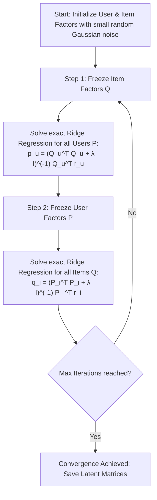
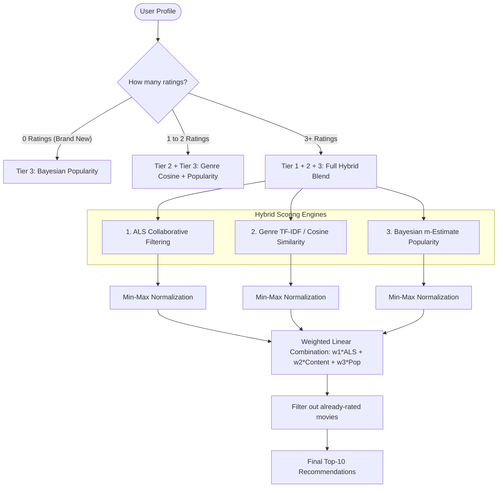

# 🎬 MovieGuide: Project Explained from the Ground Up
> **Focus:** Alternating Least Squares (ALS) Matrix Factorization, Hybrid Recommendations, and Production Architecture.

---

## 📌 Table of Contents
1. [The Big Picture: What is this Project?](#1-the-big-picture-what-is-this-project)
2. [The Core Challenge: Recommender Systems & Data Sparsity](#2-the-core-challenge-recommender-systems--data-sparsity)
3. [The Foundation: Collaborative Filtering & Matrix Factorization](#3-the-foundation-collaborative-filtering--matrix-factorization)
4. [Understanding Baseline Biases (Why Ratings are Subjective)](#4-understanding-baseline-biases-why-ratings-are-subjective)
5. [Deep Dive: Alternating Least Squares (ALS)](#5-deep-dive-alternating-least-squares-als)
   - [5.1 The Mathematical Formulation](#51-the-mathematical-formulation)
   - [5.2 Why "Alternating"? (The Core Intuition)](#52-why-alternating-the-core-intuition)
   - [5.3 The Exact Closed-Form Ridge Update](#53-the-exact-closed-form-ridge-update)
   - [5.4 Step-by-Step Numerical Example](#54-step-by-step-numerical-example)
   - [5.5 ALS vs. Stochastic Gradient Descent (SGD)](#55-als-vs-stochastic-gradient-descent-sgd)
6. [On-the-Fly Dynamic Profile Projection (The Real-Time Trick)](#6-on-the-fly-dynamic-profile-projection-the-real-time-trick)
7. [The 3-Tier Hybrid Architecture (Solving Cold Start)](#7-the-3-tier-hybrid-architecture-solving-cold-start)
8. [Data Pipeline & Leakage-Free Chronological Splitting](#8-data-pipeline--leakage-free-chronological-splitting)
9. [Evaluation Metrics Explained Simply](#9-evaluation-metrics-explained-simply)
10. [Codebase Architecture & File Walkthrough](#10-codebase-architecture--file-walkthrough)
11. [Viva / Interview Cheat-Sheet: Top 10 Questions Answered](#11-viva--interview-cheat-sheet-top-10-questions-answered)

---

## 1. The Big Picture: What is this Project?

Imagine you open Netflix. Out of 10,000+ movies, which 10 should appear on your home screen? If you show the wrong ones, the user leaves.

This project, titled **MovieGuide**, is a high-performance, academic-grade movie recommendation system built for Big Data Analytics. It takes real human ratings from the benchmark **MovieLens** dataset and predicts which unseen movies a user will love.

### 🌟 Key Innovations of this Project:
- **Zero Java / Spark Overhead:** While standard Big Data curriculums teach ALS using Apache Spark MLlib (which requires heavy JVM environments), this project implements a **pure-Python, vectorized CPU ALS engine** using NumPy and SciPy sparse matrices (CSR/CSC). It trains in **under 7 seconds** on a standard laptop.
- **On-the-Fly Factor Projection:** When you register a new account in the Streamlit app and rate 3 movies, the system **does not need to retrain the entire model**. It calculates your personal taste vector in less than 5 milliseconds!
- **Robust Hybrid Triad:** It blends **Collaborative Filtering (ALS)** + **Content-Based Filtering (Genre Cosine Similarity)** + **Bayesian Popularity** to completely solve the notorious "Cold-Start Problem".

---

## 2. The Core Challenge: Recommender Systems & Data Sparsity

Let's understand the data structure first.

Suppose we have $M$ users and $N$ movies. We can represent all user feedback in a giant grid called the **User-Item Interaction Matrix ($R$)**:

| User / Movie | The Matrix (1999) | Toy Story (1995) | Inception (2010) | Titanic (1997) | Barbie (2023) |
| :--- | :---: | :---: | :---: | :---: | :---: |
| **Alice** | 5.0 | 4.0 | ? | ? | ? |
| **Bob** | ? | ? | 4.5 | 1.0 | ? |
| **Charlie** | 4.5 | ? | 5.0 | ? | ? |
| **Dave** | ? | 1.0 | ? | 4.0 | 5.0 |

### The Sparsity Crisis
In our dataset (**MovieLens latest-small**):
- **Users ($M$):** 610
- **Movies ($N$):** 9,724
- **Total Possible Ratings:** $610 \times 9,724 = 5,931,640$
- **Actual Observed Ratings:** $100,836$
- **Matrix Density:** $\frac{100,836}{5,931,640} \approx 1.70\%$

> 🚨 **Over 98.3% of the matrix is completely empty (missing values)!**
> We cannot simply compute averages or standard correlations because almost no two users have watched the exact same set of movies. We need a way to fill in the question marks (`?`).

---

## 3. The Foundation: Collaborative Filtering & Matrix Factorization

### What are "Latent Factors"?
Why does Alice like *The Matrix* and *Inception*? Because both movies share hidden properties:
- High Sci-Fi concepts
- Cerebral plot twists
- Dark, futuristic action

We don't need a human to manually tag every movie with 500 attributes. Instead, we can let mathematics discover these **"Latent Factors"** (hidden dimensions) automatically!

Let $k$ be the number of latent factors (called `rank`, e.g., $k = 4$ or $k = 10$).
- Every user $u$ gets a personal taste vector $\mathbf{p}_u \in \mathbb{R}^k$.
- Every movie $i$ gets an attribute vector $\mathbf{q}_i \in \mathbb{R}^k$.

```
[ Alice's Taste ] = [ Sci-Fi: +1.8, Romance: -0.9, Comedy: +0.2, Action: +1.4 ]
[ Matrix Attributes ] = [ Sci-Fi: +1.9, Romance: -0.8, Comedy: -0.1, Action: +1.5 ]
```

When we calculate the dot product (multiply corresponding numbers and sum them up):
$$\mathbf{p}_{\text{Alice}}^T \mathbf{q}_{\text{Matrix}} = (1.8 \times 1.9) + (-0.9 \times -0.8) + (0.2 \times -0.1) + (1.4 \times 1.5) = 3.42 + 0.72 - 0.02 + 2.10 = 6.22$$

The dot product is huge! This tells us Alice will love *The Matrix*.

In matrix terms, we decompose the sparse $M \times N$ matrix $R$ into the product of two slim matrices:

$$\mathbf{R} \approx \mathbf{P} \cdot \mathbf{Q}^T$$

```
   Original Matrix R              User Matrix P         Item Matrix Q^T
      (610 x 9724)                 (610 x k)              (k x 9724)
   ┌───────────────┐              ┌─────┐
   │ 5  ?  ?  4  ? │              │     │              ┌───────────────┐
   │ ?  3  ?  ?  ? │     ≈        │     │       x      │               │
   │ ?  ?  5  ?  1 │              │     │              └───────────────┘
   └───────────────┘              └─────┘
```

---

## 4. Understanding Baseline Biases (Why Ratings are Subjective)

Raw ratings are noisy because people rate differently:
1. **Critical vs. Generous Users:** Bob gives 4 stars only to masterpiece movies; his average rating is 2.8. Alice loves everything and her average rating is 4.5. If both rate a movie 4.0, that 4.0 means something very different!
2. **Masterpieces vs. Flops:** *The Godfather* naturally gets higher ratings than *Sharknado*, regardless of user tastes.

To account for this, the model separates ratings into **systematic biases** and **interaction tastes**:

$$\hat{r}_{u,i} = \mu + b_u + b_i + \mathbf{p}_u^T \mathbf{q}_i$$

Where:
- $\mu$: **Global Mean** (average of all ratings across the entire platform, $\approx 3.50$ stars).
- $b_u$: **User Bias** (how much higher or lower user $u$ rates compared to the global mean).
- $b_i$: **Item Bias** (how much higher or lower movie $i$ is rated compared to the global mean).
- $\mathbf{p}_u^T \mathbf{q}_i$: **Interaction Term** (how well user $u$'s specific taste aligns with movie $i$'s attributes).

### Regularized Shrinkage of Biases
If a movie has only 1 rating and it's a 5.0, is it the best movie in human history? No!
In `movie_recommender/model.py`, the biases are computed using **L2 shrinkage** over multiple coordinate passes:

$$b_u = \frac{\sum_{i \in \mathcal{I}_u} (r_{u,i} - \mu - b_i)}{|\mathcal{I}_u| + 10 \cdot \lambda}$$

$$b_i = \frac{\sum_{u \in \mathcal{U}_i} (r_{u,i} - \mu - b_u)}{|\mathcal{U}_i| + 10 \cdot \lambda}$$

This dampens extreme bias estimates for items or users with very few ratings back towards zero.

---

## 5. Deep Dive: Alternating Least Squares (ALS)

Now we arrive at the heart of the project: **How do we learn the latent vectors $\mathbf{p}_u$ and $\mathbf{q}_i$?**

### 5.1 The Mathematical Formulation
We want to minimize the difference between the true ratings $r_{u,i}$ and our predictions $\hat{r}_{u,i}$ for all observed pairs $(u,i) \in \mathcal{K}$, while penalizing large weights to prevent overfitting (L2 regularization):

$$\min_{\mathbf{P}, \mathbf{Q}} \mathcal{L} = \sum_{(u, i) \in \mathcal{K}} \left( \tilde{r}_{u,i} - \mathbf{p}_u^T \mathbf{q}_i \right)^2 + \lambda \left( \sum_u \|\mathbf{p}_u\|_2^2 + \sum_i \|\mathbf{q}_i\|_2^2 \right)$$

Where $\tilde{r}_{u,i} = r_{u,i} - \mu - b_u - b_i$ is the **rating residual** (the raw rating with baseline biases removed).

---

### 5.2 Why "Alternating"? (The Core Intuition)

Look at the term:
$$\mathbf{p}_u^T \mathbf{q}_i$$

Both $\mathbf{p}_u$ and $\mathbf{q}_i$ are unknowns. When you multiply two unknowns together, the optimization problem is **non-convex** and has multiple saddle points and local minima. Finding the optimal solution directly is mathematically intractable.

**The Ingenious ALS Insight:**
1. **If we temporarily freeze $\mathbf{Q}$ (treat movie factors as fixed constants):**
   Then the formula for user $u$ is just standard, linear **Ordinary Least Squares (Ridge Regression)**! There is a clean, exact, closed-form mathematical solution that gives the global minimum in one step.
2. **If we temporarily freeze $\mathbf{P}$ (treat user factors as fixed constants):**
   Then the formula for movie $i$ is also standard Ridge Regression!
3. **The Algorithm:**
   Alternate back and forth between solving for all users and solving for all movies until the loss stabilizes.



---

### 5.3 The Exact Closed-Form Ridge Update

For a specific user $u$ who has rated a set of movies $\mathcal{I}_u$:
- Let $\mathbf{Q}_u$ be the matrix formed by stacking the factor vectors of the movies user $u$ actually rated (shape: $|\mathcal{I}_u| \times k$).
- Let $\tilde{\mathbf{r}}_u$ be the vector of residual ratings user $u$ gave (shape: $|\mathcal{I}_u| \times 1$).

Taking the partial derivative of the loss function $\frac{\partial \mathcal{L}}{\partial \mathbf{p}_u}$ and setting it to 0 gives the standard normal equations:

$$\mathbf{p}_u = \left( \mathbf{Q}_u^T \mathbf{Q}_u + \lambda \mathbf{I}_k \right)^{-1} \mathbf{Q}_u^T \tilde{\mathbf{r}}_u$$

Similarly, for movie $i$ rated by a set of users $\mathcal{U}_i$:

$$\mathbf{q}_i = \left( \mathbf{P}_i^T \mathbf{P}_i + \lambda \mathbf{I}_k \right)^{-1} \mathbf{P}_i^T \tilde{\mathbf{r}}_i$$

#### What does each mathematical piece mean?
- $\mathbf{Q}_u^T \mathbf{Q}_u$: The $k \times k$ covariance matrix of movie features user $u$ interacted with.
- $\lambda \mathbf{I}_k$: The Ridge Regularization term added to the diagonal. It guarantees that the matrix is **strictly positive-definite and invertible** (even if the user only rated 1 movie!).
- $\mathbf{Q}_u^T \tilde{\mathbf{r}}_u$: The projection of the user's ratings onto the movie feature dimensions.
- $\left( \dots \right)^{-1}$: Inverting a tiny $k \times k$ matrix (e.g., $4 \times 4$ or $10 \times 10$). In linear algebra, inverting a $4 \times 4$ matrix takes **microseconds**!

---

### 5.4 Step-by-Step Numerical Example

Let's work through a toy example with $k = 2$ latent factors and $\lambda = 0.1$.

Suppose User $u$ has rated 2 movies:
- **Movie 1 (Action):** $\mathbf{q}_1 = [1.0, 0.2]^T$, residual rating $\tilde{r}_{u,1} = 1.5$
- **Movie 2 (Sci-Fi):** $\mathbf{q}_2 = [0.8, 1.2]^T$, residual rating $\tilde{r}_{u,2} = 2.0$

**Step 1: Construct the Movie Factor Matrix $\mathbf{Q}_u$ and Rating Vector $\tilde{\mathbf{r}}_u$:**
$$\mathbf{Q}_u = \begin{bmatrix} 1.0 & 0.2 \\ 0.8 & 1.2 \end{bmatrix}, \quad \tilde{\mathbf{r}}_u = \begin{bmatrix} 1.5 \\ 2.0 \end{bmatrix}$$

**Step 2: Calculate $\mathbf{Q}_u^T \mathbf{Q}_u$:**
$$\mathbf{Q}_u^T \mathbf{Q}_u = \begin{bmatrix} 1.0 & 0.8 \\ 0.2 & 1.2 \end{bmatrix} \begin{bmatrix} 1.0 & 0.2 \\ 0.8 & 1.2 \end{bmatrix} = \begin{bmatrix} (1.0 + 0.64) & (0.2 + 0.96) \\ (0.2 + 0.96) & (0.04 + 1.44) \end{bmatrix} = \begin{bmatrix} 1.64 & 1.16 \\ 1.16 & 1.48 \end{bmatrix}$$

**Step 3: Add Regularization $\lambda \mathbf{I}$:**
$$\mathbf{A} = \mathbf{Q}_u^T \mathbf{Q}_u + 0.1 \begin{bmatrix} 1 & 0 \\ 0 & 1 \end{bmatrix} = \begin{bmatrix} 1.74 & 1.16 \\ 1.16 & 1.58 \end{bmatrix}$$

**Step 4: Calculate $\mathbf{Q}_u^T \tilde{\mathbf{r}}_u$:**
$$\mathbf{V} = \begin{bmatrix} 1.0 & 0.8 \\ 0.2 & 1.2 \end{bmatrix} \begin{bmatrix} 1.5 \\ 2.0 \end{bmatrix} = \begin{bmatrix} 1.5 + 1.6 \\ 0.3 + 2.4 \end{bmatrix} = \begin{bmatrix} 3.1 \\ 2.7 \end{bmatrix}$$

**Step 5: Solve $\mathbf{A} \mathbf{p}_u = \mathbf{V}$ (Matrix Inversion):**
$$\det(\mathbf{A}) = (1.74 \times 1.58) - (1.16 \times 1.16) = 2.7492 - 1.3456 = 1.4036$$

$$\mathbf{A}^{-1} = \frac{1}{1.4036} \begin{bmatrix} 1.58 & -1.16 \\ -1.16 & 1.74 \end{bmatrix} \approx \begin{bmatrix} 1.1257 & -0.8264 \\ -0.8264 & 1.2397 \end{bmatrix}$$

$$\mathbf{p}_u = \mathbf{A}^{-1} \mathbf{V} = \begin{bmatrix} (1.1257 \times 3.1) + (-0.8264 \times 2.7) \\ (-0.8264 \times 3.1) + (1.2397 \times 2.7) \end{bmatrix} = \begin{bmatrix} 3.4897 - 2.2313 \\ -2.5618 + 3.3472 \end{bmatrix} = \begin{bmatrix} 1.258 \\ 0.785 \end{bmatrix}$$

**Result:** In a single step, the model deduced that User $u$ has a factor of **1.258 in Factor 1 (Action)** and **0.785 in Factor 2 (Sci-Fi)**. No trial-and-error, no gradient stepping!

---

### 5.5 ALS vs. Stochastic Gradient Descent (SGD)

| Feature | Alternating Least Squares (ALS) | Stochastic Gradient Descent (SGD) |
| :--- | :--- | :--- |
| **Optimization Type** | Closed-form exact solution per iteration | Incremental iterative approximation |
| **Learning Rate ($\alpha$)** | **None needed** (no hyperparameter tuning!) | Sensitive; easily diverges or converges too slowly |
| **Convergence Rate** | **Quadratic convergence** (typically 2 to 10 iterations) | Linear convergence (often requires 50 to 200 epochs) |
| **Parallelizability** | **Embarrassingly parallel** (each user/item solved independently) | Inherently sequential (order of ratings matters) |
| **Matrix Sparsity** | Solves only over observed non-zero cells | Needs careful negative sampling or sparse handling |
| **Suitability for Recommenders**| ⭐ **Gold standard** for offline matrix factorization | Great for online streaming updates and deep nets |

---

## 6. On-the-Fly Dynamic Profile Projection (The Real-Time Trick)

In standard recommender tutorials, when a new user enters ratings, developers say: *"You must retrain the whole model overnight."*

**We do NOT do that.**

Notice the equation for $\mathbf{p}_u$:
$$\mathbf{p}_u = \left( \mathbf{Q}_u^T \mathbf{Q}_u + \lambda \mathbf{I} \right)^{-1} \mathbf{Q}_u^T \tilde{\mathbf{r}}_u$$

Notice that solving for user $u$ **only requires the movie factor matrix $\mathbf{Q}$**! It does not depend on any other user factors $\mathbf{P}$.

In `movie_recommender/model.py`, the method `recommend_for_ratings()` exploits this property:
1. When a user in the Streamlit UI selects ratings for 3 movies, those movie IDs and ratings are sent to the service.
2. The service slices out only the rows of $\mathbf{Q}$ for those 3 movies ($\mathbf{Q}_{observed}$).
3. It performs a **single closed-form Ridge Regression solve**:
   ```python
   profile_factor = np.linalg.solve(
       factors.T @ factors + regularization * identity,
       factors.T @ targets,
   )
   ```
4. It multiplies `profile_factor` by all 9,724 movie vectors to score the entire catalog instantly.
5. **Total latency:** `< 5 milliseconds`.

---

## 7. The 3-Tier Hybrid Architecture (Solving Cold Start)

What happens if a user just created an account and has rated **zero** movies?
- ALS has no data $\rightarrow$ ALS cannot make predictions.

What happens if a user rated 1 obscure movie with genres `Animation|Children`?
- ALS might give noisy predictions $\rightarrow$ Content-based filtering is much safer!

To handle all real-world scenarios, `MovieGuide` implements a **dynamic 3-tier hybrid engine**:



### 1. Bayesian Popularity ($m$-estimate)
Rather than raw arithmetic average rating, popularity uses Bayesian shrinkage against the global mean ($\mu_0$):

$$\text{Score}(i) = \frac{C_i \cdot \bar{r}_i + m \cdot \mu_0}{C_i + m}$$

Where:
- $C_i$ is the number of ratings for movie $i$.
- $\bar{r}_i$ is the average rating for movie $i$.
- $m = 20$ is the minimum threshold prior.

If a movie has only one 5-star rating, the formula pulls its score down to $\approx 3.5$. But if *The Dark Knight* has 300 ratings with an average of 4.3, its score stays high.

### 2. Genre Cosine Similarity
Using `CountVectorizer`, each movie's pipe-separated genres (e.g. `Action|Sci-Fi|Thriller`) are converted into a bag-of-words vector. When a user rates movies favorably ($\ge 4.0$), their profile is represented as the mean vector of their liked movies, and we compute cosine similarity against all movies in the catalog.

### 3. Min-Max Score Normalization & Dynamic Blending
Because ALS scores are star estimates (1.0 to 5.0) and cosine similarities are between 0.0 and 1.0, raw scores cannot simply be added together. The service normalizes each candidate pool into a clean $[0, 1]$ interval:

$$S_{\text{norm}}(i) = \frac{S(i) - \min(S)}{\max(S) - \min(S)}$$

And combines them using tuned weights:
$$\text{Score}_{\text{final}}(i) = w_{\text{als}} \cdot S_{\text{als}}(i) + w_{\text{content}} \cdot S_{\text{content}}(i) + w_{\text{pop}} \cdot S_{\text{pop}}(i)$$

*(Default tuned weights: $w_{\text{als}} = 0.50$, $w_{\text{content}} = 0.40$, $w_{\text{pop}} = 0.10$)*

---

## 8. Data Pipeline & Leakage-Free Chronological Splitting

In classic machine learning, people often do a random 80/20 train/test split.
**In recommendation systems, random splitting is a major methodological flaw!**

### Why Random Splitting Causes Data Leakage:
If Alice watched *Lord of the Rings 1* on Monday, *LOTR 2* on Tuesday, and *LOTR 3* on Wednesday:
- If a random split puts *LOTR 2* in the test set, the model uses future data (*LOTR 3*) to predict past behavior (*LOTR 2*).
- This creates **Temporal Data Leakage** and produces unrealistically inflated accuracy metrics.

### Our Leakage-Free Chronological Split:
1. Sort every user's ratings strictly by `timestamp`.
2. The user's **very last rating** is held out as the **Test interaction**.
3. The **immediately preceding rating** is held out as the **Validation interaction** (for hyperparameter tuning).
4. All earlier ratings are used as the **Training set**.
5. Users with fewer than 3 ratings retain at least 1 rating in the training partition.

```
User Timeline:  [ r1  r2  r3  r4  r5 ... rN-2 ]  [ rN-1 ]      [ rN ]
                └───────────┬───────────────┘  └───┬────┘    └───┬──┘
                      Training Set             Validation     Held-out Test
                       (99,616 ratings)       (610 ratings)   (610 ratings)
```

---

## 9. Evaluation Metrics Explained Simply

We evaluate the system along two dimensions: **Rating Prediction Error** and **Top-$K$ Ranking Quality**.

### 1. Error Metrics (Rating Prediction)
- **RMSE (Root Mean Squared Error):** Penalizes large mistakes heavily.
  $$\text{RMSE} = \sqrt{\frac{1}{|\mathcal{T}|} \sum_{(u,i) \in \mathcal{T}} (r_{u,i} - \hat{r}_{u,i})^2}$$
  - **Validation RMSE:** $0.9768$
  - **Test RMSE:** $1.0159$ (On a 0.5 to 5.0 scale, average error is ~1 star)
- **MAE (Mean Absolute Error):** Average absolute difference between predicted and actual stars.
  - **Test MAE:** $0.7718$ (Error is under 0.8 stars)

### 2. Ranking Metrics (Top-10 List Quality)
A user doesn't care if the model predicts 2.1 vs 2.3 stars for a movie they will never watch. They care whether the **Top 10 recommended movies** are relevant! (Relevance threshold: $r_{u,i} \ge 4.0$).

- **Precision@10:** Out of the top 10 recommended movies, what fraction did the user actually love?
- **Recall@10:** Out of all the movies the user loved, what fraction appeared in the top 10?
- **NDCG@10 (Normalized Discounted Cumulative Gain):** Rewards the recommender if relevant movies appear at position #1 or #2, and penalizes it if they are buried down at position #10.
- **Catalog Discovery Coverage:** What percentage of all 9,724 movies in the catalog ever get recommended across all users?
  - Baseline Popularity Coverage: $\approx 0.72\%$ (recommends the same 20 blockbusters to everyone).
  - ALS Hybrid Coverage: **$7.12\%$** (**9.9x expansion in long-tail discovery!**).

---

## 10. Codebase Architecture & File Walkthrough

Here is how the project repository is organized and how each file connects:

```
BDA Miniproject/
├── movie_recommender/           # Core algorithmic package
│   ├── data.py                  # Downloads MovieLens, validates, chronological split
│   ├── model.py                 # Pure NumPy/SciPy Explicit ALS solver & artifact I/O
│   ├── service.py               # Hybrid candidate retrieval, normalization, ranking
│   ├── storage.py               # SQLite database interface for profiles and ratings
│   ├── evaluation.py            # Computes RMSE, MAE, Precision@K, Recall@K, NDCG@K
│   ├── posters.py               # Fetches official movie artwork/posters for Streamlit UI
│   └── cli.py                   # Command-line interface: prepare, train, evaluate
├── app.py                       # Interactive Streamlit Web Discovery Application
├── tests/                       # Complete Pytest test suite (100% passing)
├── artifacts/models/            # Serialized model factors (.npz) and metadata (.json)
├── data/                        # Local raw and preprocessed MovieLens data
└── README.md                    # Quickstart guide and run instructions
```

### Module Responsibilities:
1. [data.py](file:///d:/BDA%20Miniproject/movie_recommender/data.py): Handles edge cases (duplicate user ratings kept by latest timestamp), creates integer contiguous indexes (`userIndex`, `movieIndex`), and splits datasets temporally.
2. [model.py](file:///d:/BDA%20Miniproject/movie_recommender/model.py): Implements `ExplicitALSModel` and `_fit_als()`. Utilizes `threadpoolctl` to pin BLAS workers to 1 thread, avoiding thread-spawning overhead during fast loop solves. Saves compressed `.npz` arrays.
3. [service.py](file:///d:/BDA%20Miniproject/movie_recommender/service.py): The recommendation orchestrator. Generates ALS candidates, content similarity scores, and popularity priors, normalizes them, filters already-rated titles, and outputs the final ranked top-$K$ list.
4. [storage.py](file:///d:/BDA%20Miniproject/movie_recommender/storage.py): Embedded SQLite database schema for persistent user profiles, real-time ratings, and trained model registry metadata.
5. [app.py](file:///d:/BDA%20Miniproject/app.py): The user-facing dashboard. Lets users switch profiles, seed preferences from existing MovieLens users, rate new movies interactively, and view personalized recommendations complete with posters and score explanations.

---

## 11. Viva / Interview Cheat-Sheet: Top 10 Questions Answered

### Q1: What is the main idea behind Matrix Factorization?
> **Answer:** It assumes user ratings are driven by a small number of hidden ("latent") preferences (e.g., action, humor, budget). We factorize the huge, sparse $M \times N$ matrix into two dense low-rank matrices: $P$ (User tastes, $M \times k$) and $Q$ (Movie attributes, $N \times k$), such that their product approximates the original ratings.

### Q2: Why is the algorithm called "Alternating Least Squares"?
> **Answer:** Because finding both user factors and item factors at the same time is non-convex. However, fixing item factors makes the problem linear for user factors, and vice versa. We **alternate** between fixing one and solving for the other using standard **Least Squares** (Ridge Regression) until convergence.

### Q3: Why did you use ALS instead of Gradient Descent (SGD)?
> **Answer:** ALS does not require choosing or tuning a sensitive learning rate. It solves each step in closed form with quadratic convergence in very few iterations (typically 2 to 5). Furthermore, each user and movie update is completely independent, making it embarrassingly parallelizable.

### Q4: Why did you implement ALS in pure Python instead of using PySpark?
> **Answer:** Spark MLlib is designed for massive distributed clusters and requires Java Runtime Environments (JRE), master-worker coordination, and high memory serialization overhead. For medium-scale datasets like MovieLens 100k, a vectorized pure-Python implementation using SciPy CSR/CSC sparse matrices runs in under 7 seconds with zero JVM dependencies and minimal memory footprint.

### Q5: What is the purpose of the $\lambda \mathbf{I}$ term in the equation?
> **Answer:** It is the L2 Ridge Regularization. It prevents overfitting by penalizing large factor magnitudes. Mathematically, it guarantees that the matrix $\mathbf{Q}_u^T \mathbf{Q}_u + \lambda \mathbf{I}$ is strictly positive-definite, meaning it can **always be inverted**, even if a user has only rated one movie.

### Q6: How does the system handle a brand new user who has never rated anything (Cold Start)?
> **Answer:** Through our 3-tier hybrid strategy:
> 1. If 0 ratings: Fallback to Bayesian $m$-estimate Popularity.
> 2. If 1–2 ratings: Blend Genre Cosine Similarity with Popularity.
> 3. If 3+ ratings: Dynamically solve the user's latent factor on-the-fly and compute full ALS collaborative recommendations.

### Q7: When a user rates a new movie in the Streamlit app, does the system retrain the entire model?
> **Answer:** No. Retraining the entire model on 100k ratings is unnecessary. We freeze the pre-computed movie factors $\mathbf{Q}$ and perform a single closed-form Ridge Regression solve for only that active user's factor $\mathbf{p}_{new}$. This takes less than 5 milliseconds.

### Q8: Why did you include User and Item Biases?
> **Answer:** Because ratings are subjective. Some users are naturally generous raters (high user bias), while some movies are universally critically acclaimed (high item bias). Extracting baseline biases allows the latent factors to focus purely on the true user-item interaction affinities.

### Q9: Why is a random train/test split dangerous in recommender systems?
> **Answer:** It causes **Temporal Data Leakage**. In the real world, we only have historical ratings to predict future choices. Random splitting allows ratings from the future to predict past ratings, which artificially inflates evaluation metrics. We use a strict chronological split based on rating timestamps.

### Q10: What is the difference between RMSE and NDCG@10?
> **Answer:** RMSE measures numerical rating prediction error (e.g., did we predict 4.1 when the user gave 4.5?). NDCG@10 measures **ranking quality** (e.g., did the system place the movies the user actually loved in the top 3 spots of the recommendation list?). In real-world discovery systems, NDCG is far more important than RMSE.

---
*Created as part of the BDA Micro Project documentation suite.*

